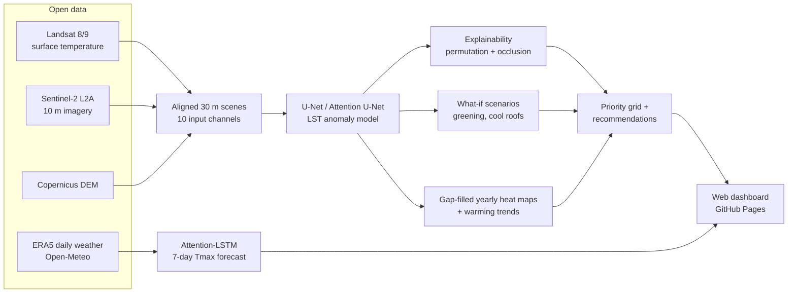

# Urban Heat Intelligence

**Deep learning for urban heat-risk mapping, heat forecasting and explainable cooling recommendations — case study: Pune, India.**

[](https://github.com/palakgoswami454/urban-heat-intelligence/actions/workflows/run-pipeline.yml)
[](https://github.com/palakgoswami454/urban-heat-intelligence/actions/workflows/tests.yml)

**Live dashboard:** https://palakgoswami454.github.io/urban-heat-intelligence/

Cities are getting hotter, and the heat is not spread evenly: dense, concrete-heavy neighbourhoods
can be many degrees hotter at the surface than leafy ones a kilometre away. This project builds an
end-to-end system that

1. **maps** surface heat across the city from satellite imagery every summer since 2019,
2. **learns** with a U-Net how land cover and terrain create that heat (and fills cloud gaps),
3. **explains** *why* each neighbourhood is hot (vegetation loss? impervious surfaces?),
4. **simulates** cooling interventions (urban greening, cool roofs) with the trained model,
5. **ranks** neighbourhoods by priority for action, and
6. **forecasts** daily maximum temperature 7 days ahead with an attention-LSTM that runs live in the browser.

Everything — data download, training, evaluation, figures and the website — runs on GitHub
(GitHub Actions + GitHub Pages). No paid services, accounts or API keys are needed.

---

## System overview



| Component | Method | Why |
|---|---|---|
| Heat target | Landsat Collection-2 L2 surface temperature (ST_B10), expressed as **anomaly vs. the city median** of each scene | removes day-to-day weather so the model learns *where* is hotter, not *when* |
| Inputs | Sentinel-2 B2, B3, B4, B8, B11, B12 + NDVI, NDBI, MNDWI + elevation | vegetation, built-up, water, albedo and terrain signals |
| Main model | **U-Net** and **Attention U-Net** (encoder–decoder CNN, skip connections, additive attention gates) | spatial context: a pixel is hotter when its surroundings are concrete |
| Baselines | city median, linear regression, gradient boosting, per-pixel MLP (no spatial context) | shows what deep learning and spatial context add |
| Validation | **spatial block cross-validation** (whole map blocks held out) | tests on neighbourhoods the model never saw, avoiding spatial leakage |
| Explainability | permutation importance (global), occlusion attribution in °C (local, per area) | answers *why is this area hot?* |
| Recommendations | counterfactual inputs run through the trained model: 30 % vegetation blend, +0.15 roof reflectance | estimates cooling per area and picks the stronger intervention |
| Priority score | 55 % heat anomaly + 30 % built-up exposure + 15 % warming trend (percentile ranks) | where action helps most people |
| Forecasting | **LSTM with temporal attention**, 30-day window → max temperature days +1…+7, vs. persistence / climatology / ridge | early warning of heat-stress days |
| Deployment | JSON + PNG exports, Leaflet dashboard, LSTM re-implemented in JavaScript (verified against PyTorch) | live forecast without a server |

## Run it (entirely on GitHub)

1. **Enable the website:** *Settings → Pages → Build and deployment → Source: **GitHub Actions***.
2. **Run the pipeline:** *Actions → **Run pipeline** → Run workflow*. It downloads the data, trains all
   models and commits the results (about 1–3 hours on GitHub's free CPU runners; watch the six steps live).
3. **Open the dashboard** at `https://palakgoswami454.github.io/urban-heat-intelligence/`. Until step 2 finishes the
   site shows clearly-labelled **demo data**.

Results: [`outputs/RESULTS.md`](outputs/RESULTS.md) (tables + all figures). Trained model weights are attached to each
workflow run as a downloadable artifact.

### Other ways to run

**Google Colab (free GPU, faster):** open `notebooks/Urban_Heat_Intelligence_Pune.ipynb` in Colab and run all cells.

**Locally:**
```bash
pip install torch --index-url https://download.pytorch.org/whl/cpu
pip install -r requirements.txt
python run_pipeline.py                 # full run (real data)
python run_pipeline.py --demo          # 1-minute offline smoke test on synthetic data
python -m http.server -d web 8000      # dashboard at http://localhost:8000
```

Change the city by editing `bbox`, `utm_crs` and `point` in `src/uhi/config.py`.

## Repository structure

```
run_pipeline.py              CLI: download -> train -> analyze -> forecast -> figures -> export
src/uhi/
  config.py                  study area, dates, hyper-parameters
  data_satellite.py          Landsat LST + Sentinel-2 + DEM from Microsoft Planetary Computer
  data_weather.py            ERA5 daily weather from Open-Meteo
  dataset.py                 scenes, spatial block split, normalisation, patch sampling
  models.py                  U-Net, Attention U-Net, pixel MLP, attention-LSTM
  train_lst.py               training loop, baselines, full-scene tiled inference, metrics
  analysis.py                explainability, what-if scenarios, gap filling, trends, grid, recommendations
  forecast.py                forecaster training, baselines, heat-day detection, JS export
  figures.py                 report figures
  export_web.py              dashboard data + outputs/RESULTS.md
  synthetic.py               synthetic data for offline tests (demo mode)
web/                         dashboard (Leaflet + Chart.js, static, GitHub Pages)
notebooks/                   Colab notebook
tests/                       JS-vs-PyTorch consistency test
.github/workflows/           run-pipeline, deploy-pages, tests
```

## Limitations

- Landsat measures **surface** temperature at ~10:30 am local time, not the air temperature people feel;
  surface and air heat are related but not identical.
- Cooling estimates come from the model's learned relationships (counterfactual inputs), not from physical
  simulation; they indicate *relative* potential and should be validated before any real intervention.
- Satellite brightness is confounded with land use (bright surfaces in the training data are often hot
  bare soil or concrete), so the cool-roof scenario can be underestimated by a data-driven model.
- "Exposure" uses built-up fraction as a proxy for population; adding gridded population (e.g. WorldPop)
  and vulnerability data would turn the heat-exposure score into a fuller heat-*risk* score.
- The browser forecast uses Open-Meteo's recent model analysis as input, which differs slightly from the
  ERA5 data used in training.

## Data sources

- Landsat 8/9 Collection 2 Level-2 — USGS, via [Microsoft Planetary Computer](https://planetarycomputer.microsoft.com/dataset/landsat-c2-l2)
- Sentinel-2 Level-2A — ESA Copernicus, via [Planetary Computer](https://planetarycomputer.microsoft.com/dataset/sentinel-2-l2a)
- Copernicus DEM GLO-30 — via [Planetary Computer](https://planetarycomputer.microsoft.com/dataset/cop-dem-glo-30)
- ERA5 reanalysis daily weather — via [Open-Meteo](https://open-meteo.com/) (CC BY 4.0)
- Base map © OpenStreetMap contributors © CARTO

## License

MIT
