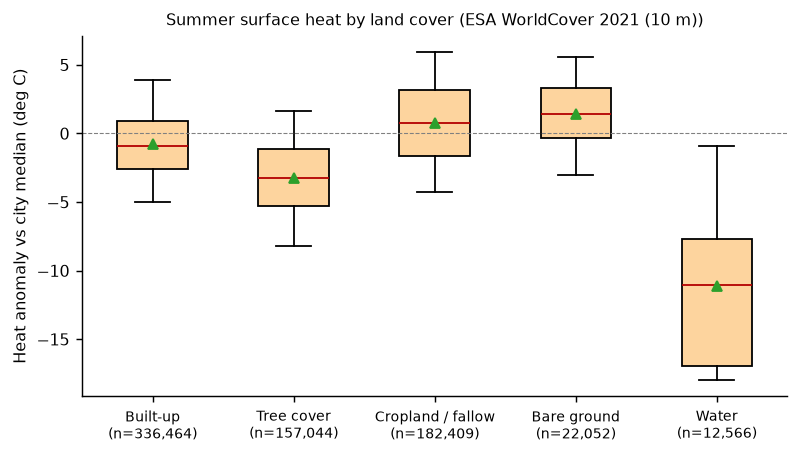

# Results

Generated 2026-10-19 13:21 UTC. Study area: Pune. 18 summer scenes from 2019-03-02 to 2025-05-05.

## 1. Land surface temperature model (test = held-out spatial blocks)

| Model | RMSE (C) | MAE (C) | R2 | Hotspot F1 | Params |
|---|---|---|---|---|---|
| city_median (no model) | 4.025 | 3.197 | -0.004 | 0.172 | - |
| linear_regression | 2.847 | 2.254 | 0.498 | 0.480 | - |
| gradient_boosting | 2.567 | 2.017 | 0.592 | 0.527 | - |
| pixel_mlp | 2.647 | 2.077 | 0.566 | 0.517 | 4929 |
| unet **(selected)** | 1.667 | 1.285 | 0.828 | 0.665 | 1929025 |
| attention_unet | 1.686 | 1.297 | 0.824 | 0.662 | 1950868 |

Model selection: lowest validation RMSE. Patches: {'train': 2248, 'val': 540, 'test': 648}.

## 2. Explainability - permutation importance (increase in test RMSE, C)

- Vegetation: 3.431
- Built-up / impervious: 1.855
- Water / moisture: 1.041
- Visible reflectance (albedo): 0.682
- Terrain (elevation): 0.110

## 3. Hotspots and cooling scenarios

- Reference scene: 2025-05-05 (city median LST 47.78 C)
- Grid cells: 3591 of ~510 m; hotspots: 360 (heat anomaly >= 4.41 C, years [2023, 2024, 2025])
- Mean modelled surface cooling in hotspots: greening -5.22 C, cool roofs -0.27 C
- Recommendations for hotspots: {'water': 0, 'protect_green': 249, 'greening': 52, 'cool_roofs': 0, 'bare_land': 59, 'monitor': 0}
- Land cover source: ESA WorldCover 2021 (10 m)
- Hotspots by dominant cover: {'built-up (>=30%)': 40, 'bare / fallow (>=40%)': 64, 'other': 256}
- Hotspots in built-up areas (urban hotspots): 40; their recommendations: {'water': 0, 'protect_green': 6, 'greening': 34, 'cool_roofs': 0, 'bare_land': 0, 'monitor': 0}
- Mean modelled surface cooling in urban hotspots: greening -5.36 C, cool roofs -1.48 C
- Mean heat anomaly of mostly built-up cells: -1.1605988593155891 C; of mostly bare/fallow cells: 0.20234541577825163 C

Heat anomaly by land cover (recent summers, pixels with >=50% of the class):

- Built-up: mean -0.78 C, median -0.93 C (n=336464)
- Tree cover: mean -3.24 C, median -3.23 C (n=157044)
- Cropland / fallow: mean +0.75 C, median +0.78 C (n=182409)
- Bare ground: mean +1.40 C, median +1.43 C (n=22052)
- Water: mean -11.13 C, median -11.06 C (n=12566)

Surface heat contrast per year (C):

| Year | Built-up minus vegetated | Built-up minus bare/fallow |
|---|---|---|
| 2019 | -1.98 | -1.76 |
| 2020 | -0.97 | -0.68 |
| 2021 | -0.75 | -0.98 |
| 2022 | -1.15 | -0.88 |
| 2023 | -1.24 | -1.67 |
| 2024 | -1.79 | -1.92 |
| 2025 | -1.17 | -1.20 |

## 4. 7-day max temperature forecast (test period 2022-12-31 .. 2026-10-12)

| Method | MAE all leads | MAE +1d | MAE +3d | MAE +7d | Heat-day F1 +1d | Heat-day F1 +3d |
|---|---|---|---|---|---|---|
| persistence | 1.359 | 0.817 | 1.336 | 1.655 | 0.699 | 0.466 |
| climatology | 1.617 | 1.609 | 1.614 | 1.624 | 0.000 | 0.000 |
| ridge_regression | 1.221 | 0.764 | 1.213 | 1.454 | 0.562 | 0.178 |
| attention_lstm | 1.238 | 0.812 | 1.221 | 1.448 | 0.457 | 0.026 |

Heat-stress day = daily max >= 39.0 C (90th percentile of March-May daily max temperature in training years).

## Figures

